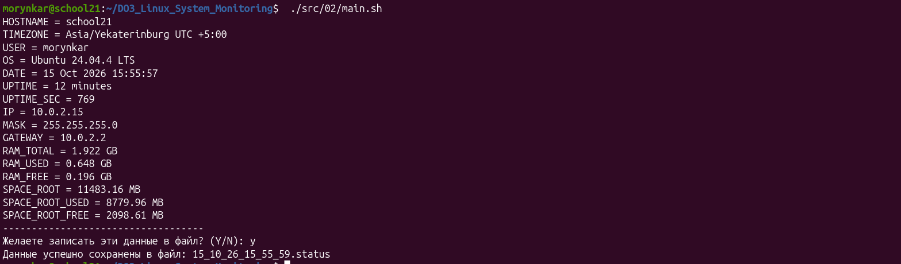
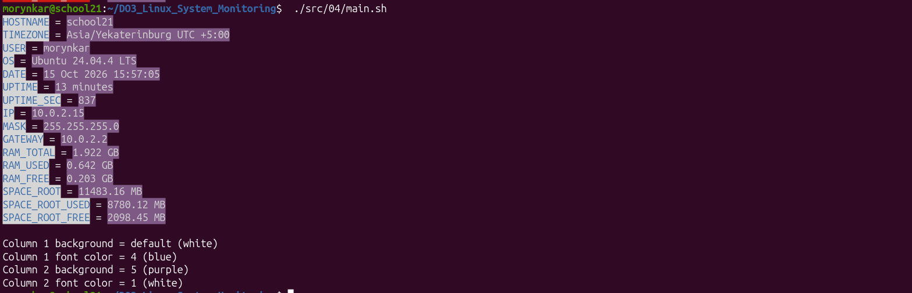
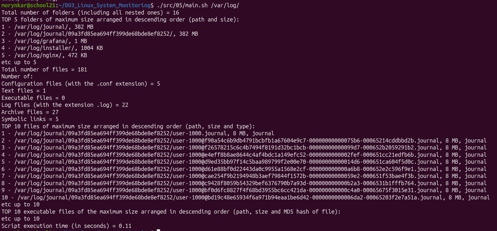

# DO3 — Linux System Monitoring

Набор Bash-утилит для проверки входных данных, сбора сведений о Linux-системе и анализа содержимого каталогов. Проект последовательно развивает один сценарий: от простой обработки аргумента до настраиваемого цветного отчёта и поиска наиболее крупных файлов.

## Документация

**[Открыть подробный отчёт по Parts 1–5 →](docs/walkthrough.md)**

В отчёте объяснены назначение каждой части, порядок запуска, проверки входных данных и развитие решения между этапами.

## Возможности

- проверка количества и формата аргументов;
- получение hostname, пользователя, ОС, времени работы и часового пояса;
- вывод IPv4-адреса, маски и шлюза по умолчанию;
- расчёт использования памяти и корневого раздела;
- сохранение системного отчёта в файл `.status`;
- настройка цветов через аргументы или конфигурационный файл;
- анализ каталогов, типов файлов, размеров и MD5 исполняемых файлов;
- корректная обработка путей и имён с пробелами.

## Структура

```text
src/01/  проверка одного аргумента
src/02/  системный отчёт и сохранение результата
src/03/  цветной отчёт с параметрами командной строки
src/04/  цветовая схема из settings.conf
src/05/  анализ файловой системы
tests/   автоматические проверки
docs/    подробное описание этапов
```

## Требования

Проект разрабатывался для Ubuntu Server 20.04 LTS и повторно проверен на Ubuntu 24.04.4 LTS. Используются Bash 4+, GNU Coreutils, `iproute2`, `systemd`, `awk`, `find`, `md5sum` и `ifconfig` из пакета `net-tools`:

```bash
sudo apt update
sudo apt install net-tools shellcheck
```

## Быстрый запуск

Команды можно выполнять из корня проекта:

```bash
./src/01/main.sh monitoring
./src/02/main.sh
./src/03/main.sh 1 6 2 4
./src/04/main.sh
./src/05/main.sh /var/log/
```

Для Part 4 цвета задаются в [`src/04/settings.conf`](src/04/settings.conf). Пустое значение означает использование встроенного цвета по умолчанию.

## Примеры результата

| Системный отчёт | Настраиваемые цвета | Анализ файловой системы |
|---|---|---|
|  |  |  |

## Проверка

```bash
./tests/run-tests.sh
bash -n src/01/main.sh src/02/*.sh src/03/*.sh src/04/*.sh src/05/*.sh
shellcheck -x src/01/main.sh src/02/main.sh src/03/main.sh src/04/main.sh src/05/main.sh tests/run-tests.sh
```

Тестовый сценарий проверяет 16 случаев, включая некорректные аргументы, конфликт цветов, отсутствующий каталог, архивы, символические ссылки и пути с пробелами.

## Ограничения

Системные показатели зависят от текущего состояния машины. Сценарии ориентированы на GNU/Linux и используют GNU-расширения `find`, `sort` и `du`. Part 1 сохраняет исходное правило: числом считается аргумент, полностью состоящий из цифр; например, `123` отклоняется, а `-7` обрабатывается как текст.
