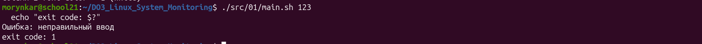
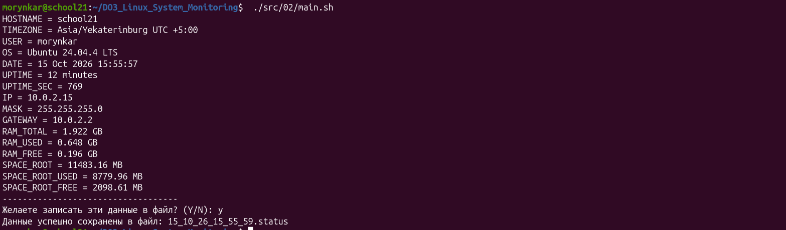
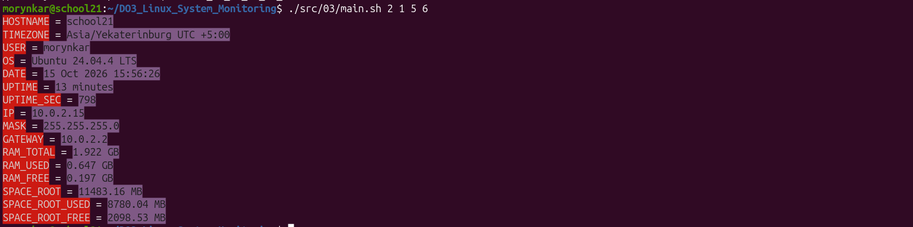
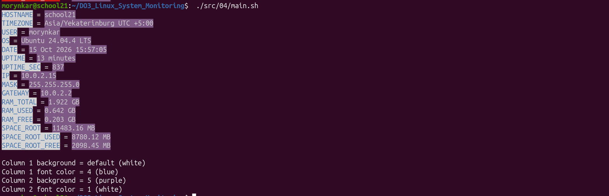
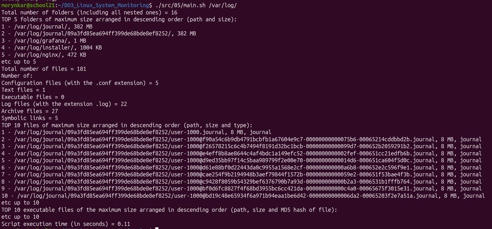

# Пошаговый отчёт

[← README](../README.md) · [Part 1](#part-1-проверка-аргумента) · [Part 2](#part-2-системный-отчёт) · [Part 3](#part-3-цвета-из-аргументов) · [Part 4](#part-4-конфигурационный-файл) · [Part 5](#part-5-анализ-файловой-системы)

---

## Part 1. Проверка аргумента

Первый сценарий демонстрирует работу с позиционными параметрами и кодами завершения. Он принимает ровно один аргумент, выводит текст и отклоняет строку, полностью состоящую из цифр.

```bash
./src/01/main.sh monitoring
./src/01/main.sh 123
```

Проверка `^[0-9]+$` намеренно сохранена из выполненной лаборатории. Отрицательные и дробные значения не входят в этот шаблон и рассматриваются как текст.

Корректный текстовый аргумент выводится без изменений:


Последовательность цифр отклоняется, а код завершения `1` позволяет вызывающему процессу определить ошибку:



[↑ К навигации](#пошаговый-отчёт) · [Следующий этап: Part 2 →](#part-2-системный-отчёт)

---

## Part 2. Системный отчёт

Сценарий собирает сведения из стандартных интерфейсов Linux: `/etc/os-release`, `/proc/uptime`, `timedatectl`, `ip`, `ifconfig`, `free` и `df`. Логика разделена на сбор данных, формирование строк и вывод.

```bash
./src/02/main.sh
```

После вывода программа предлагает сохранить результат. При ответе `Y` или `y` создаётся файл вида `DD_MM_YY_HH_MM_SS.status`; остальные ответы отменяют запись.

На контрольном запуске получены сведения об Ubuntu, сети, памяти и корневом разделе; отчёт успешно сохранён:



[← Part 1](#part-1-проверка-аргумента) · [↑ К навигации](#пошаговый-отчёт) · [Следующий этап: Part 3 →](#part-3-цвета-из-аргументов)

---

## Part 3. Цвета из аргументов

Системный отчёт дополнен ANSI-цветами. Четыре числа определяют фон и цвет текста для названий и значений. Разрешены индексы от 1 до 6; цвет текста не должен совпадать с фоном своего столбца.

```bash
./src/03/main.sh 1 6 2 4
```

Некорректное количество параметров, текст вместо индекса, выход за диапазон или совпадающая пара приводят к понятному сообщению и ненулевому коду завершения.

Аргументы `2 1 5 6` задают красный фон с белым текстом для названий и фиолетовый фон с чёрным текстом для значений:



[← Part 2](#part-2-системный-отчёт) · [↑ К навигации](#пошаговый-отчёт) · [Следующий этап: Part 4 →](#part-4-конфигурационный-файл)

---

## Part 4. Конфигурационный файл

Цветовая схема перенесена в [`settings.conf`](../src/04/settings.conf), поэтому основной сценарий запускается без аргументов:

```bash
./src/04/main.sh
```

Если параметр оставлен пустым, применяется встроенное значение. После системных данных выводится фактически использованная схема и отмечается, какие цвета были получены из настроек по умолчанию.

В показанной конфигурации фон первого столбца не указан, поэтому программа использует стандартный белый цвет и отмечает его словом `default`:



[← Part 3](#part-3-цвета-из-аргументов) · [↑ К навигации](#пошаговый-отчёт) · [Следующий этап: Part 5 →](#part-5-анализ-файловой-системы)

---

## Part 5. Анализ файловой системы

Заключительный сценарий принимает существующий каталог с завершающим `/` и строит сводку его содержимого:

- количество каталогов и файлов;
- пять крупнейших каталогов;
- число конфигураций, текстов, логов, архивов, исполняемых файлов и ссылок;
- десять крупнейших файлов с типом и размером;
- десять крупнейших исполняемых файлов с MD5;
- время выполнения анализа.

```bash
./src/05/main.sh /var/log/
```

Для безопасной обработки пробелов и специальных символов результаты `find` передаются через NUL-разделители. Перед анализом проверяются количество аргументов, существование каталога и завершающий слеш.

Анализ `/var/log/` показывает крупнейшие каталоги и файлы, распределение по типам и фактическое время выполнения:



[← Part 4](#part-4-конфигурационный-файл) · [↑ К навигации](#пошаговый-отчёт) · [Завершить и вернуться в README →](../README.md)
